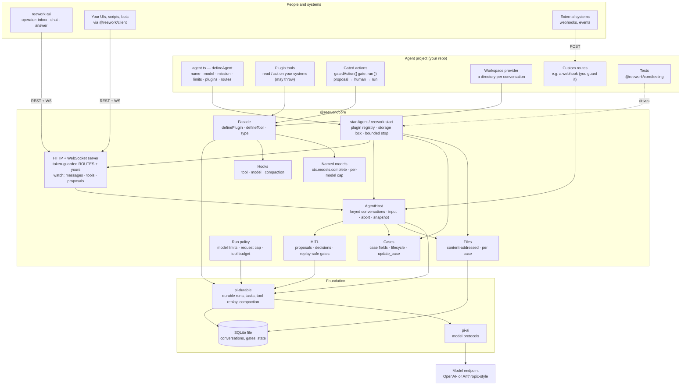

# Architecture

A reework project is an **agent project**: its own repository that depends on the `@reework/*` packages and
holds everything specific to its use case. reework itself is a thin building block on top of pi-durable; it
adds only what any agent would use unchanged (the second-agent test in `reespec/decisions.md`).

## The layers

| Layer                                    | Owns                                                                                                                                                                                                          | Does not own                                                            |
| ---------------------------------------- | ------------------------------------------------------------------------------------------------------------------------------------------------------------------------------------------------------------- | ----------------------------------------------------------------------- |
| **Agent project**                        | The agent definition, its plugins (tools, gated actions, workspace), custom routes, deployment, tests                                                                                                         | Durability, the protocol, approvals mechanics                           |
| **`@reework/core`**                      | Booting an agent from a definition, the in-process `AgentHost` and its HTTP/WS protocol, gated actions and proposals, cases and files, named models and hooks, run policy, the plugin facade, the testing kit | Anything about a particular domain (no domain tools, routes or clients) |
| **`@reework/client` / `@reework/types`** | The protocol client and its conversation view; the shared vocabulary (`Message`, `AgentEvent`, `Proposal`, `ROUTES`)                                                                                          | Rendering                                                               |
| **`@reework/tui`**                       | The native operator surface, drawn from the client's view                                                                                                                                                     | Agent logic (it is only a client)                                       |
| **pi-durable / pi-ai**                   | Durable execution over SQLite, tool replay, compaction; model wire protocols                                                                                                                                  | — (reached only through the facade)                                     |

## How work flows

1. **Input arrives** — from a client (`submitInput`), or from a custom route that maps an external event to a
   conversation (`createConversation({ key })`, deduplicated with `requestId`).
2. **The agent runs** — pi-durable drives model turns and tool calls; every step is committed to SQLite, so a
   restart continues where it stopped. Run policy bounds it: the model's limits, the endpoint request cap, the
   tool-round budget.
3. **Effects that need a human** go through a gated action: a proposal (title, options, attachments) opens and
   the tool tells the model nothing has happened yet.
4. **A human decides** on any surface (TUI, client, API). The action runs, and the agent is resumed with the
   decision and the result as a new message.
5. **Surfaces watch** the conversation's stream — messages, tool calls with status, proposals opening and
   closing, case updates — and render it from `@reework/client`'s view.

**Authors.** Input can say who it is from — `from: { kind: "human" | "system" | "agent", id?, name? }` on
submit, stored on the entry and shown on messages and snapshots — and gate decisions carry the same author as
`decidedBy`. Absence means unattributed, never a human; and since the API token is the trusted-operator
boundary — any holder of it can claim `human` — an author records what the caller declared rather than proof,
until scoped tokens exist. Channel transports verify their own identities before passing one through.

## Pausing intake

`agent.pause()` / `host.pause()` stops admitting **new** input without cutting off work already admitted. One
durable, session-scoped intake document holds the pause state and the held inputs, so "paused" and "this input is
held" commit atomically and a restart forgets neither: a paused agent restarts paused. Every input path goes through
`host.submitInput`, so the interception is one door — the conversation check, the headless refusal, file resolution
and the case reopen happen as today, then while paused the resolved content is appended to the held list with its
own id, author and `requestId`, `onInput` fires at acceptance, and no submission reaches pi-durable: `submitInput`
answers `{ submissionId, held: true }` with no message, and the HTTP route answers `202`. Runs in progress continue,
proposals stay answerable, and a decision on an existing gate continues that case's run — a decided gate is work
reaching rest, not new intake. `agent.resume()` commits the resumed state, then admits held input in arrival order
within each conversation, one submission each (`whenBusy: "followUp"`), removing each entry only after admission;
different conversations run concurrently, as they would had the agent never paused. A synthesized
`"held:<id>"` requestId closes the crash window, and a not-paused agent with leftover held input drains it at boot.
`activeRuns` counts every placed input submission agent-wide; `heldInputs` is the held list's length.

Three token-guarded routes drive it: `POST /pause`, `POST /resume` and `GET /status`, each answering an
`AgentStatus` (`paused`, `pausedAt?`, `resumedAt?`, `activeRuns`, `heldInputs`) and idempotent for retries. `/health`
stays the unauthenticated liveness probe and carries no state. The activity stream reports the same state (below).

**Stop order.** `agent.stop()` closes upgraded sockets, the activity hub and the servers, aborts the agent signal,
drains queued event hooks, then closes the engine — the interrupt: it signals every run and tool invocation and
joins them without writing an outcome, so the tasks stay pending in storage like a crash. Plugin `stop()` runs after
that, in reverse declaration order, through a stop-only engine opened over the same storage so a stopping plugin can
still commit and read; progress calls are refused during the window (`AgentStopping`, HTTP `409 agent_stopping`).
The storage lock releases last.

## The activity stream

A surface that needs the whole agent rather than one conversation opens `GET /activity/ws` — one socket per agent,
behind the API token like every built-in route (a token-less or wrong-token handshake fails with 401 and no socket
opens). The first frame is a snapshot of the agent's open work: runs answering input (`runId`, conversation id,
`key` when the conversation has one, `caseKind`), open proposals (id, title, audience, option id/label, `createdAt`),
and cases needing a human (title, status, stage, priority, owner, `needsHuman`, `openProposals`), plus the agent's
intake state (`agent`: `paused`, `pausedAt?`, `resumedAt?`, `activeRuns`, `heldInputs`). Every later frame is one
event; there is no batch buffer, because activity events are small and a fleet surface wants immediacy.

The events are `run_started`/`run_ended` (`runId`, and `completed` or `unanswered` at the end),
`tool_started`/`tool_finished` (`callId`, tool name, and `done` or `error` with `durationMs` when the stream saw the
start), `proposal_opened`/`proposal_settled` (the gate's question and the chosen option with its decider),
`case_changed` (status, stage, priority, owner, `needsHuman`, `openProposals`) and `model_usage` (source `run` or
`plugin`, the model, and token counts). Every conversation event carries the conversation identity — id, `key` when
present, and `caseKind`. One agent-level kind, `agent_state` (`paused`, `pausedAt?`, `resumedAt?`, `activeRuns`,
`heldInputs`), is published on pause and resume and, while paused, on every run start and end, so a drainer can watch
`activeRuns` fall to zero without reconnecting; it names no conversation.

**No content.** The stream never carries message text, tool arguments or output, streamed text, proposal
descriptions or attachments, case summaries or tags, or a decision's free-form instruction. It is state, not
transcript: a surface that needs the conversation's messages or tool detail opens `conversations.watch` for that
conversation.

**Filters.** `?keyPrefix=<prefix>` keeps conversations whose key starts with the prefix (a conversation created
without a key never matches), and `?tag=<tag>` keeps conversations carrying every given tag — repeat the parameter
or comma-separate tags, as `conversations.list` does. Both together are AND, and the snapshot echoes the filter that
was applied. Filtering is enforced per subscriber on every publish and in the snapshot, so a filtered stream reveals
nothing about conversations outside it: not their ids, keys, case fields, proposal ids, run ids or tool call ids.
`agent_state` is agent state, not conversation state, so it is sent to every subscriber regardless of its filter and
carries no conversation fields. It
scopes what a surface asks for; it is not authorization (the token is the operator boundary).

**Observation.** A reconnect is a new connection and gets a fresh snapshot of current open work, then live events
resume; there is no cursor and no replay of events missed while disconnected. The stream stays open until the client
closes it or the agent stops — no idle timeout and no maximum duration. Keep-alive is the protocol's own: `ws`
answers ping frames with pong frames. The hub attaches one shared watcher per matching conversation that is a desk
or an open/waiting case; a closed case is not watched (its in-flight run stays watched until it ends), and it is
watched again when input reopens it. Conversations created later attach on their first case write, proposal or usage.

**Stop and slow clients.** On `agent.stop()` every activity socket closes with code `1001` and reason
`agent stopping` before the servers close, under the stop deadline, and the hub stops its watchers. Publishing never
awaits a socket: each subscriber has a bounded queue (`activity.maxBufferedBytes`, default 1 MiB, and
`activity.maxPendingEvents`, default 4096) and a flush on `setImmediate` that stops while the socket's buffered amount
is above the byte bound. A subscriber that overflows closes with code `1008` and reason `slow consumer` and is
dropped; runs, other subscribers and the server are unaffected. The bounds are set by the deployment through
`startAgent`'s `activity` option, not by the client.

`@reework/client` exposes `watchActivity(onFrame, { keyPrefix?, tag? })`, which resolves once the socket opened,
delivers the snapshot first and then event frames, and returns `close()`. `@reework/core/testing` exposes
`openActivityStream(target, options?)` and `activityWatcherCount(target)` for tests against a real agent.

## Cases, files, hooks and named models

Every conversation is a **case** or a **desk**: case fields are stored flat on the conversation record,
written by the host, plugins (`ctx.case`), the `update_case` model tool and HTTP, validated field by
field, with a lifecycle (closing refused with open proposals, input reopening a closed case). A desk
is a principal's ongoing conversation that routes to many cases: it stays out of case listings by
default, cannot be closed, and carries `kind: "desk"` to plugins. A case may carry an `owner` — one
stable author for a principal that spans identities — settable at creation or by patch. A plugin that
declares `{ cases: true }` gets `ctx.cases` to list, read, snapshot, submit input to, decide and update
other cases as a principal. Files are content-addressed bytes beside the SQLite file, listed per case,
uploaded/downloaded over the protocol and read/added by plugins (`ctx.files`) and gated-action
attachments. Hooks (`beforeTool`, `afterTool`, `beforeModelRequest`, `afterModelResponse`, `onAnswer`,
`beforeCompaction`) let plugins shape the run; `onAnswer` also names the input that started the run
(`submissionId` and `from`). Named models give a plugin its own endpoint (`ctx.models.complete`) with
its own request cap, and settled proposals stay readable through `listProposals({ status: "settled" })`.
All of these reach pi-durable only through the facade; the facade's `@reework/core/internal` entry (the
`Engine`, the storage seam) is **unstable** and only for the framework's own tests.

## Deploying

An agent is one Node process: `reework start agent.ts --storage <file>` (or `startAgent` from code), serving the
API. State is the SQLite file; keep it on a volume and run one process per file (the storage lock enforces it).
Secrets come from the environment (`apiKeyEnv`, `REEWORK_API_TOKEN`). In a container, give the stop grace period
more than the agent's 8 s stop timeout.

See [plugins.md](plugins.md) for the plugin contract and the testing kit.
