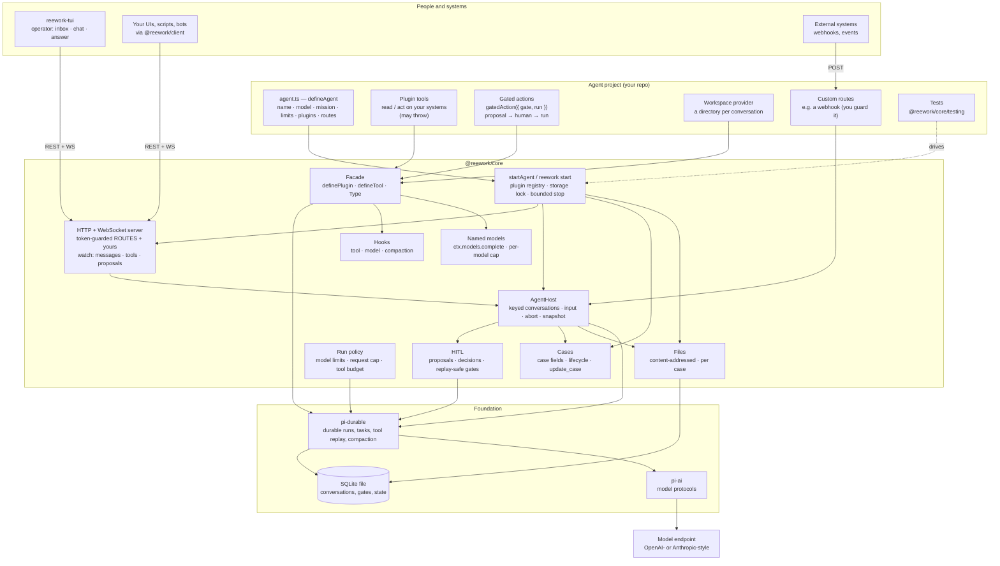

# Architecture

A reework project is an **agent project**: its own repository that depends on the `@reework/*` packages and
holds everything specific to its use case. reework itself is a thin building block on top of pi-durable; it
adds only what any agent would use unchanged (the second-agent test in `reespec/decisions.md`).

## The layers

| Layer                                    | Owns                                                                                                                                                                                                          | Does not own                                                            |
| ---------------------------------------- | ------------------------------------------------------------------------------------------------------------------------------------------------------------------------------------------------------------- | ----------------------------------------------------------------------- |
| **Agent project**                        | The agent definition, its plugins (tools, gated actions, workspace), custom routes, deployment, tests                                                                                                         | Durability, the protocol, approvals mechanics                           |
| **`@reework/core`**                      | Booting an agent from a definition, the in-process `AgentHost` and its HTTP/WS protocol, gated actions and proposals, cases and files, named models and hooks, run policy, the plugin facade, the testing kit | Anything about a particular domain (no domain tools, routes or clients) |
| **`@reework/client` / `@reework/types`** | The protocol client and its conversation view; the shared vocabulary (`Message`, `AgentEvent`, `Proposal`, `ROUTES`)                                                                                          | Rendering                                                               |
| **`@reework/tui`**                       | The native operator surface, drawn from the client's view                                                                                                                                                     | Agent logic (it is only a client)                                       |
| **pi-durable / pi-ai**                   | Durable execution over SQLite, tool replay, compaction; model wire protocols                                                                                                                                  | — (reached only through the facade)                                     |

## How work flows

1. **Input arrives** — from a client (`submitInput`), or from a custom route that maps an external event to a
   conversation (`createConversation({ key })`, deduplicated with `requestId`).
2. **The agent runs** — pi-durable drives model turns and tool calls; every step is committed to SQLite, so a
   restart continues where it stopped. Run policy bounds it: the model's limits, the endpoint request cap, the
   tool-round budget.
3. **Effects that need a human** go through a gated action: a proposal (title, options, attachments) opens and
   the tool tells the model nothing has happened yet.
4. **A human decides** on any surface (TUI, client, API). The action runs, and the agent is resumed with the
   decision and the result as a new message.
5. **Surfaces watch** the conversation's stream — messages, tool calls with status, proposals opening and
   closing, case updates — and render it from `@reework/client`'s view.

## Cases, files, hooks and named models

Every conversation is a **case**: fields stored flat on the conversation record, written by the host,
plugins (`ctx.case`), the `update_case` model tool and HTTP, validated field by field, with a lifecycle
(closing refused with open proposals, input reopening a closed case). Files are content-addressed bytes
beside the SQLite file, listed per case, uploaded/downloaded over the protocol and read/added by plugins
(`ctx.files`) and gated-action attachments. Hooks (`beforeTool`, `afterTool`, `beforeModelRequest`,
`afterModelResponse`, `onAnswer`, `beforeCompaction`) let plugins shape the run; named models give a
plugin its own endpoint (`ctx.models.complete`) with its own request cap. All of these reach pi-durable
only through the facade; the facade's `@reework/core/internal` entry (the `Engine`, the storage seam) is
**unstable** and only for the framework's own tests.

## Deploying

An agent is one Node process: `reework start agent.ts --storage <file>` (or `startAgent` from code), serving the
API. State is the SQLite file; keep it on a volume and run one process per file (the storage lock enforces it).
Secrets come from the environment (`apiKeyEnv`, `REEWORK_API_TOKEN`). In a container, give the stop grace period
more than the agent's 8 s stop timeout.

See [plugins.md](plugins.md) for the plugin contract and the testing kit.
